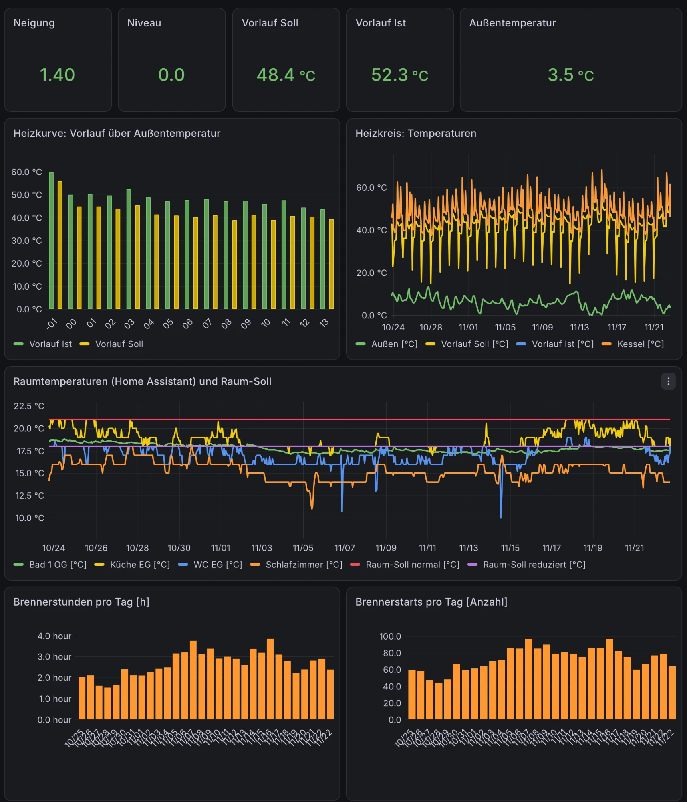
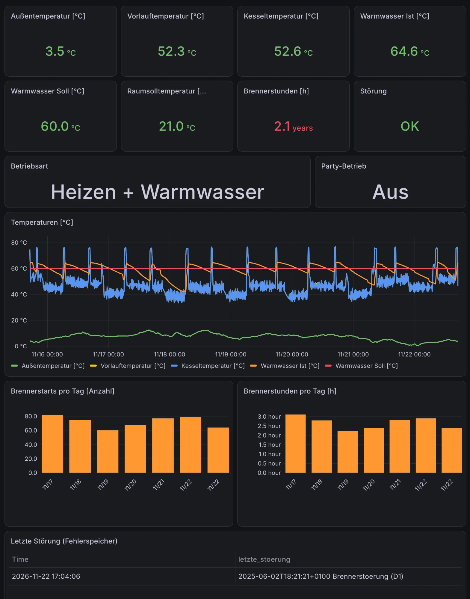

# Heating Monitor — Viessmann boiler to InfluxDB, Grafana, Home Assistant and Apple Home

Read-only monitoring for a **Viessmann boiler** via the Optolink interface.
A small Linux server reads the boiler every minute with [vcontrold](https://github.com/bublath/vcontrold),
stores the values in InfluxDB, shows them in Grafana, sends push alerts through Home Assistant, and
exposes temperatures to Apple Home through Homebridge.

> **Note:** This project was developed with the help of AI (Claude by Anthropic). The idea, the requirements, the hardware setup, and the testing on my own system are mine; the scripts and dashboards were written in collaboration with an AI assistant.





## What it does

- **Reads** outdoor, flow, boiler, hot water, and room temperatures, burner hours and starts, operating mode, heating curve values, and the fault memory.
- **Stores** everything in InfluxDB 2 (bucket `heizung`, 30-day raw retention) and daily aggregates in a longer-lived bucket.
- **Visualises** it in Grafana: current values, heating curve, room temperatures, burner starts and hours per day, fault history.
- **Alerts** on your phone via Home Assistant when the boiler reports a fault or a new fault-memory entry.
- **Shows** temperatures and the fault state in **Apple Home** through Homebridge (MQTT plugin).
- **Compares** EV charging energy with diesel cost per month (optional, see `scripts/diesel_savings.py`).

**The system is read-only by design.** The scripts never write settings to the boiler. Setting commands (hot water schedule, room setpoints, operating mode) exist in vcontrold but are deliberately not used here.

## Architecture

```
Viessmann boiler ──Optolink (USB)──► vcontrold ──► bridge.sh (cron, every minute)
                                                   │
                     ┌─────────────────────────────┼──────────────────────────────┐
                     ▼                             ▼                              ▼
                InfluxDB 2                 Mosquitto (MQTT)               Home Assistant
                (bucket heizung)                  │                    (room sensors, notify)
                     │                            ▼                              │
                  Grafana                    Homebridge ──► Apple Home ◄── HomeKit bridge (optional)
                                                   
alarm.sh (cron, every 5 min) ── vclient ──► Home Assistant notify ──► iPhone push
```

## Hardware and software

| Part | Purpose |
|---|---|
| Viessmann boiler with Optolink-capable controller | Source of the data |
| Optolink USB adapter (USB-serial, e.g. CH340 based) | Physical connection to the boiler's service port |
| Linux server (Debian / Ubuntu) | Runs everything in the background |
| [vcontrold](https://github.com/bublath/vcontrold) | Talks to the boiler and answers `vclient` requests over TCP |
| Docker + Docker Compose | Containers for Mosquitto, Homebridge, InfluxDB, Grafana |
| Mosquitto | MQTT broker for Homebridge |
| Homebridge + `homebridge-mqtt` | Exposes temperatures and fault sensor to Apple Home |
| InfluxDB 2.x and Grafana | Time-series storage and dashboards |
| Home Assistant | Room temperatures, push notifications, optional HomeKit bridge |

## Setup overview

> The steps below describe the setup at a high level. Each component has its own documentation. Adjust paths, IPs, and entity IDs to your environment.

### 1. Connect the boiler and run vcontrold

- Connect the Optolink adapter to the boiler and to the server.
- Configure vcontrold with your device (for Viessmann: the device ID printed in its config list) and a TCP port, for example `3002`.
- Check it works:

  ```bash
  vclient -h 127.0.0.1:3002 -c getTempA
  ```

Tip: A sensible udev rule gives the adapter a fixed name (e.g. `/dev/optolink`). After re-plugging the adapter, vcontrold may need a restart.

### 2. Create secrets (never commit these)

Store every secret in its own file with mode `600` in the base directory (default `/opt/heating`):

| File | Content |
|---|---|
| `mqtt.pass` | Password of the MQTT user used by the bridge |
| `influx_token` | InfluxDB token with write access to `heizung` (and `heizung_tage`) |
| `ha_token` | Home Assistant long-lived access token |

```bash
chmod 600 /opt/heating/*.pass /opt/heating/*_token
```

Copy `.env.example` to `.env` for the non-secret settings and load them in your cron environment.

### 3. Run the bridge and alarm scripts

Copy `scripts/` to the server and add these lines to the crontab (`crontab -e`):

```cron
PATH=/usr/local/bin:/usr/bin:/bin
* * * * *     flock -n /tmp/bridge.lock timeout 55 /opt/heating/bridge.sh
*/5 * * * *   flock -n /tmp/alarm.lock  timeout 55 /opt/heating/alarm.sh
10 6 * * *    /usr/bin/python3 /opt/heating/diesel_savings.py
```

> **Pitfall:** Cron has a minimal `PATH`. Without the first line the `vclient` command is not found, and the bridge silently writes nothing.

Test the alarm path once:

```bash
/opt/heating/alarm.sh --test
```

### 4. Run InfluxDB, Grafana, Mosquitto, and Homebridge

See [`config/docker-compose.example.yml`](config/docker-compose.example.yml) for a starting point.

- Create an InfluxDB organisation (e.g. `home`) and two buckets: `heizung` (short retention, raw values) and `heizung_tage` (unlimited, daily values).
- Add InfluxDB as a Grafana data source (Flux).
- Mosquitto: create a user for the bridge and listen on port `1883` inside the Docker network only.
- Homebridge: install `homebridge-mqtt` and add the configuration from [`config/homebridge-mqtt.example.json`](config/homebridge-mqtt.example.json).

### 5. Add the Apple Home integration

There are **two ways** to get the data into Apple Home. You can use either or both.

#### Option A: Homebridge (recommended for the heating sensors)

The bridge publishes accessories to the MQTT topic `homebridge/to/add` and updates their values on `homebridge/to/set`. Homebridge creates these as HomeKit accessories:

| Accessory | HomeKit type | Source |
|---|---|---|
| Heating outside temperature | Temperature sensor | `getTempA` |
| Heating flow temperature | Temperature sensor | `getTempVListM1` |
| Hot water actual / target | Temperature sensor | `getTempWWist`, `getTempWWsoll` |
| Heating fault | Contact sensor | `getStatusStoerung` |

Steps:
1. Start Homebridge and pair it with the Home app (scan the QR code or enter the pairing code shown in the Homebridge UI).
2. Run `bridge.sh` once. The accessories appear automatically in the Home app.
3. Put them into rooms, and build automations, e.g. a notification when the fault contact opens.

#### Option B: Home Assistant HomeKit Bridge

If your sensors already live in Home Assistant (e.g. room temperatures from Bluetooth or Zigbee sensors), expose them to Apple Home with the built-in **HomeKit Bridge** integration:

```yaml
# configuration.yaml (or a separate file included from it)
homekit:
  - name: Home
    port: 21064
    filter:
      include_entities:
        - sensor.bathroom_temperature
        - sensor.kitchen_temperature
        - sensor.bedroom_temperature
```

Then add the bridge in the Home app with the pairing code from Home Assistant (*Settings → Devices & services → HomeKit Bridge*).

**Tip:** Do not expose the raw boiler entities through two paths at the same time. Pick Homebridge for the boiler sensors and HomeKit Bridge for the room sensors, or exclude the boiler entities in the HomeKit filter. This avoids duplicate tiles in the Home app.

### 6. Home Assistant push notifications

`alarm.sh` calls the Home Assistant notify service of your phone:

```
POST /api/services/notify/mobile_app_<your_phone>
```

Set `HA_NOTIFY_SERVICE` to your service name. The script notifies only on a **change**, so you do not get a message every five minutes while a fault is active.

## Grafana dashboards

The panels use these measurements from the bucket `heizung`:

- `heizung` — all boiler values (temperatures, burner hours and starts, operating mode code, fault flags)
- `solar` / `system` — optional, if you add your own collectors

Dashboard tips:
- Use `suffix:` units (`suffix:°C`, `suffix:h`) instead of automatic unit scaling. Some unit types scale large values automatically in unexpected ways.
- Flux `join` across buckets can be slow or confusing. Compute cross-bucket values on the server and write them as a new measurement instead.
- Burner starts and hours per day come from the difference between the last value of a day and the last value of the previous day.

## Known limitations

- Some vcontrold commands are not supported by every boiler model (e.g. the current target flow temperature or burner status on some devices return no value). The bridge simply skips missing values.
- The Optolink connection is slow (several seconds per connection), so all values are read in **one batch request** per minute.
- The Homebridge `to/add` calls are repeated every minute on purpose. The plugin ignores accessories that already exist.

## Security

- Nothing in this repo contains passwords, tokens, or addresses. Keep it that way: store secrets only in `600` files on the server.
- Do not expose ports for vcontrold, MQTT, Homebridge, InfluxDB, or Home Assistant to the internet. Use a VPN for remote access.
- Grafana with anonymous access should only be reachable inside your network.
- Keep the server and containers updated.

## License

This project is licensed under the [MIT License](LICENSE).
